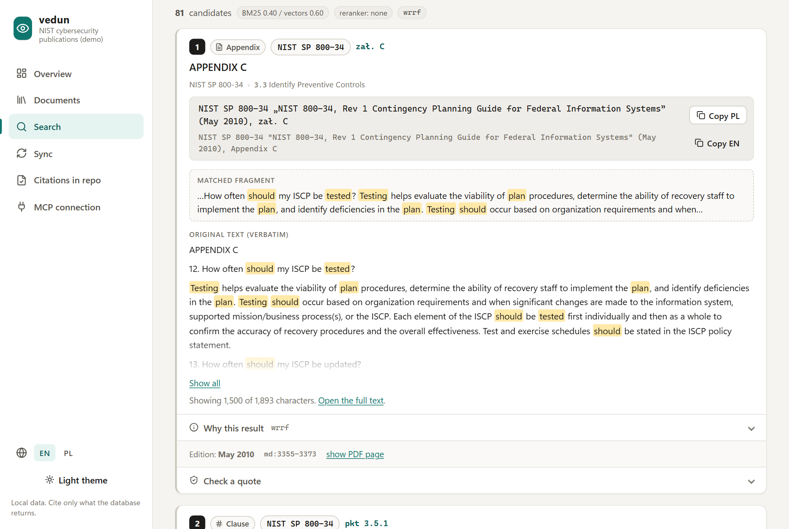
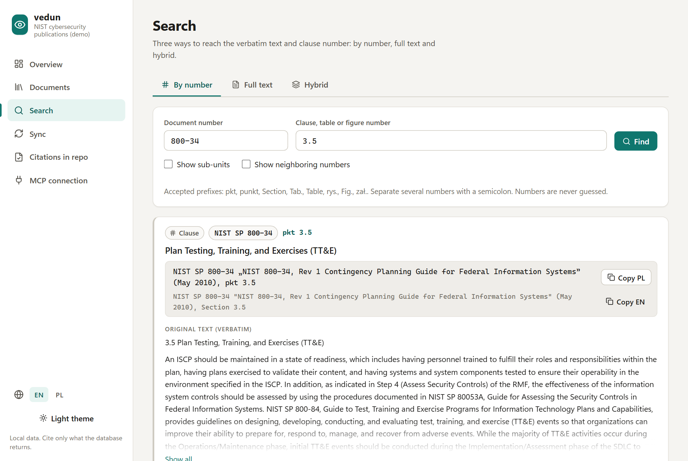
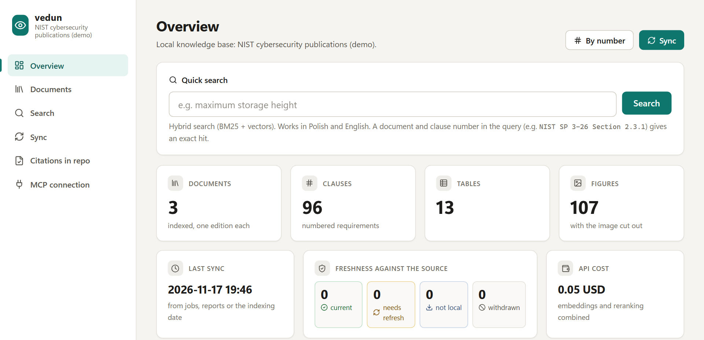
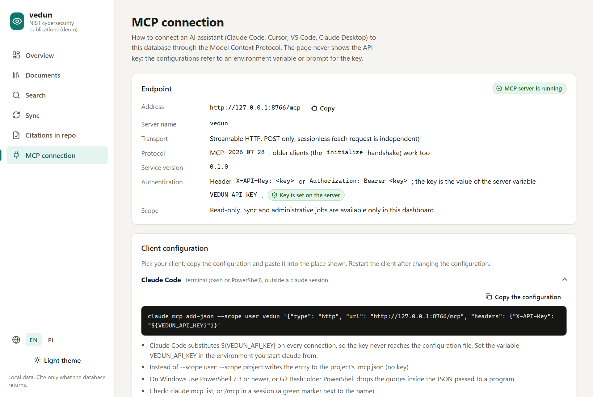

# vedun

**A local knowledge base for a collection of standards, specifications or other technical documents. Ask a question
in plain language and get the exact clause, its edition and its verbatim text, with a ready-to-paste citation.**

vedun is built for people who quote documents for a living (engineers, auditors, safety and compliance specialists)
and for the AI agents that help them. It never invents a clause number: every answer points to a real unit of a real
edition, and a quote can be checked against the PDF before it goes into a mail or a report.

- **Exact answers.** Look up a clause, table or figure by its number; search by meaning in any language; search for an
  exact phrase or number. Every hit carries the document, edition, clause id, verbatim text and a citation.
- **Quote check.** `verify_quote` confirms that a sentence really appears in that clause and in the PDF text layer.
- **Edition changes.** Replace a document with its new edition and get a report: removed, new, changed and probably
  renumbered clauses. `check-citations` then finds the references in your notes that no longer point anywhere.
- **Dashboard** (English or Polish), **REST API** and an **MCP server**, so Claude Code and other AI agents can use it.
- **Local first.** Your documents, the database and all files stay on your machine. Only embeddings (and the optional
  reranker) call an online API, and only if you give it a key.



> Status: early release (v0.1). The interface may still change. Feedback and issues are welcome.

<table>
  <tr>
    <td width="33%"><a href="docs/images/lookup.png"></a></td>
    <td width="33%"><a href="docs/images/overview.png"></a></td>
    <td width="33%"><a href="docs/images/connect.png"></a></td>
  </tr>
  <tr>
    <td><b>Exact lookup</b>: a clause by its number, with its edition and citation</td>
    <td><b>Overview</b>: what is indexed, the last sync and the API cost</td>
    <td><b>MCP connection</b>: ready-made settings for Claude Code and other agents</td>
  </tr>
</table>

<sub>Screenshots show a demo collection of three public-domain NIST Special Publications (SP 800-30, 800-34,
800-61).</sub>

## Install

You need **Docker Desktop** (Windows, macOS), **Docker Engine** or **Podman** (Linux), about 4 GB of disk for the image
and 8 GB of RAM (16 GB recommended when converting long PDFs).

**macOS / Linux**:

```bash
curl -fsSL https://raw.githubusercontent.com/numikel/vedun/main/scripts/install.sh | bash
```

The installer asks a few questions (folder, keys, language), stores the keys in your operating system's secret store,
starts the service and offers to connect Claude Code. At the end it shows the dashboard address and its login.
Flags for unattended runs (`--yes`, `--json`, `--dry-run`, …) are listed in [`scripts/README.md`](scripts/README.md).

**Windows** (PowerShell, Docker Desktop running). There is no installer script: four commands create the folder and
fetch two files you can read before running anything.

```powershell
mkdir $HOME\vedun; cd $HOME\vedun
iwr https://raw.githubusercontent.com/numikel/vedun/main/compose.release.yaml -OutFile compose.yaml
iwr https://raw.githubusercontent.com/numikel/vedun/main/scripts/vedun.ps1 -OutFile vedun.ps1
notepad .\vedun.ps1          # optional: read it (about 200 lines); it never downloads or runs other code
Unblock-File .\vedun.ps1     # files from the internet are blocked until you say you trust them
.\vedun.ps1 setup            # keys and language; keys are encrypted for your Windows user (DPAPI)
.\vedun.ps1 start
.\vedun.ps1 open             # login: .\vedun.ps1 keys show
```

If PowerShell says that running scripts is disabled, allow local scripts for your user once:
`Set-ExecutionPolicy -Scope CurrentUser RemoteSigned`. On Windows the commands below are `.\vedun.ps1 <command>`
(run in the install folder); `doctor` and `uninstall` are macOS/Linux only for now.

**With an AI agent.** Ask your coding agent: *"Install vedun from github.com/numikel/vedun, follow AGENTS.md"*. The
agent reads [`AGENTS.md`](AGENTS.md) and follows the `vedun-install` skill (see [Agent skills](#agent-skills)).

## First steps

1. `vedun open` opens the dashboard (`http://127.0.0.1:8765`). Log in with the user and password the installer showed
   (`vedun keys show-password` shows them again; on Windows `.\vedun.ps1 keys show`).
2. Put your PDFs into the `pdf` folder of the install folder (default `~/vedun/pdf`) and press **Sync** on the
   **Sync** page: the first sync of an empty knowledge base takes every document in the folder. Later, add new
   documents on the **Sync** page (upload); a later sync updates the indexed documents and adds what you upload, but
   does not pick up other files from the folder on its own. Conversion runs on your machine; the first one also
   downloads the conversion models (about 0.5 GB).
3. Search on the **Search** page, or ask your AI agent.

**File names matter.** A document is identified by its number, read from the file name `<doc_id>_<YYYYMM>.pdf`, where
`YYYYMM` is the edition (for example `4-12_202603.pdf`). Out of the box `doc_id` looks like `4-12` or `10-3A`. If your
documents are numbered differently (`ISO-45001`, `EN 54-2`), set `doc_id_pattern` in the profile first (see
[Your documents](#your-documents)). One edition per document is kept: a newer file replaces the older one.

## Everyday commands

```
vedun start | stop | status        start or stop the service, show its state
vedun open                         open the dashboard
vedun logs                         follow the service log
vedun update                       get the newest version and restart
vedun keys                         change the OpenRouter / Typesafe keys, the dashboard password, rotate the API key
vedun doctor                       check everything and say how to fix what is wrong
vedun uninstall                    remove vedun (your folders only after a second confirmation)
```

## Connect an AI agent

The MCP endpoint is `http://127.0.0.1:8765/mcp`; it needs the API key the installer generated.

- **Claude Code**: the installer can run `claude mcp add` for you. Manually:
  `claude mcp add --scope user vedun --transport http http://127.0.0.1:8765/mcp --header "Authorization: Bearer <key>"`
  (this stores the key in Claude Code's configuration).
- **Other clients** (VS Code, Cursor, Claude Desktop, …): the dashboard page **MCP connection** (`/connect`) has
  ready-made configurations to copy.

The server offers ten read-only tools (`kb_lookup`, `kb_search`, `kb_fulltext`, `kb_verify_quote`, …; the prefix is
configurable). Their descriptions tell the agent which one to use: a known clause number → `kb_lookup`, an exact phrase
or number → `kb_fulltext`, a descriptive question → `kb_search`, before quoting → `kb_verify_quote`.

## Agent skills

The repository ships three **skills** in [`skills/`](skills/): folders with a `SKILL.md` file that teach an AI coding
agent (Claude Code, Codex, Copilot, Cursor, …) one vedun task step by step. The agent asks you the questions that
matter (with a recommended answer), runs the commands, checks the result and explains each step in plain words. It
never asks you to paste a key into the chat: keys go into your secret store through `vedun keys` in your own terminal.

| Skill | Use it when you want to … | What the agent does |
|---|---|---|
| [`vedun-install`](skills/vedun-install/SKILL.md) | install, update or reinstall vedun, connect an agent to it | checks Docker or Podman, asks for the folder, language and keys in one round, installs, verifies the dashboard, connects Claude Code or prints the settings for another MCP client |
| [`vedun-add-documents`](skills/vedun-add-documents/SKILL.md) | add PDFs or a new edition, find out why a file was rejected, use your own document numbering | checks the file names against the profile, sets up `doc_id_pattern` and labels if needed, runs the sync and reads the edition report |
| [`vedun-doctor`](skills/vedun-doctor/SKILL.md) | fix a dashboard that does not open, missing MCP tools, empty search, a failed sync | runs `vedun doctor`, reads the logs, proposes one fix at a time and checks it |

**Without installing anything**, an agent can follow a skill straight from the repository: *"Install vedun from
github.com/numikel/vedun, follow AGENTS.md"* (AGENTS.md maps each task to its skill).

**To make the skills available in every project**, copy the three folders into your agent's skills folder. For Claude
Code that is `~/.claude/skills/` (all projects) or `.claude/skills/` inside one project:

```bash
# macOS / Linux
git clone --depth 1 https://github.com/numikel/vedun /tmp/vedun-skills
mkdir -p ~/.claude/skills && cp -r /tmp/vedun-skills/skills/* ~/.claude/skills/
```

```powershell
# Windows (PowerShell)
git clone --depth 1 https://github.com/numikel/vedun $env:TEMP\vedun-skills
New-Item -ItemType Directory -Force $HOME\.claude\skills | Out-Null
Copy-Item -Recurse -Force $env:TEMP\vedun-skills\skills\* $HOME\.claude\skills\
```

Restart Claude Code; the skills then start on their own when your request matches (for example *"add these PDFs to
vedun"*), or by name (`/vedun-doctor`). Other agents that read `SKILL.md` folders use the same three folders in their
own skills directory. To update the skills, repeat the copy.

## Keys and secrets

| Key | Needed for | Without it |
|---|---|---|
| `VEDUN_API_KEY` | REST API and MCP | generated by the installer |
| `VEDUN_DASH_USER`, `VEDUN_DASH_PASSWORD` | dashboard login | generated by the installer |
| `OPENROUTER_API_KEY` ([openrouter.ai](https://openrouter.ai/keys)) | embeddings: search by meaning, figures | exact lookup and full-text search still work |
| `TYPESAFE_API_KEY` ([typesafe.ai](https://typesafe.ai)) | optional reranker (better ordering) | results keep the fused order |

Keys live in the operating system's secret store: Windows (DPAPI, encrypted for your user in
`%LOCALAPPDATA%\vedun\secrets`), macOS (Keychain), Linux (Secret Service via `secret-tool`; on a headless server the
installer explains the alternatives). `vedun start` reads them and passes them to the container for that run only;
they are never written to a file in the install folder.
If you already use a secrets injector such as [kprun](https://github.com/numikel/kprun), `kprun run vedun -- vedun start`
works as well.

**Costs.** Embeddings are billed by OpenRouter per token, mostly once per document. A daily budget
(`VEDUN_DAILY_BUDGET_USD`, default 3 USD) caps API spending: when it is used up, search answers from full-text only and
says so.

## Your documents

Everything specific to a collection lives in a JSON profile, `data/vedun.config.json` in the install folder: how
document numbers look (`doc_id_pattern`), how a document is named in text (`doc_label`, e.g. `"Std {doc_id}"`), the
citation format (`citation_template`), the collection name shown in the dashboard (`corpus_name`), the dashboard
language (`ui_language`), and more. A small example is [`vedun.config.example.json`](vedun.config.example.json); every
key is described in [`docs/reference.md`](docs/reference.md#corpus-profile). A profile can extend another one
(`{"extends": "<path>"}`), so a private profile can stay outside the install folder.

Where newer editions come from can be a plugin (`source_plugin`): a small Python file that lists the publisher's
catalogue and downloads a PDF. Without a plugin, you add files yourself; everything else works the same. How to write
one, with a working example: [Writing a source plugin](docs/reference.md#writing-a-source-plugin).

## How answers are made

- **Exact lookup** never guesses: an unknown clause id returns "not found" with the nearest ids, and "possibly renumbered
  to …" after an edition change.
- **Full-text search** (SQLite FTS5) for exact phrases and numbers; no network, no cost.
- **Search by meaning**: full-text and vector search fused with weighted reciprocal-rank fusion, optionally reranked;
  works across languages (for example Polish questions over English documents).
- Every hit is an **Evidence** record: document, edition as printed, clause id and kind, verbatim text, provenance,
  scores and a citation in English and Polish. Page numbers are only internal locators.

## Security

The service listens on `127.0.0.1` only and fails closed: without its keys every protected route answers 503. API and
MCP need the API key; the dashboard uses HTTP Basic; state-changing requests carry a cross-site guard; the `Host` header
is checked (DNS rebinding); requests are rate-limited (60/min) and logged to an audit file without credentials or
content. The container runs as a non-root user with all capabilities dropped and a read-only root filesystem.
Details: [`docs/reference.md`](docs/reference.md#security).

## Third-party models and services

| Component | Used for | License / terms |
|---|---|---|
| [Docling](https://github.com/docling-project/docling) (`docling`, `docling-core`, `docling-ibm-models`, `docling-parse`) | PDF → Markdown | MIT |
| `docling-project/docling-layout-heron` (downloaded on first conversion) | page layout | Apache-2.0 |
| `docling-project/docling-models` – TableFormer (downloaded on first conversion) | table structure | [CDLA-Permissive-2.0](https://cdla.dev/permissive-2-0/) |
| [OpenRouter](https://openrouter.ai) (default model `google/gemini-embedding-2`) | embeddings, your key | OpenRouter's and the model provider's terms |
| [Typesafe Jev](https://typesafe.ai) (optional) | reranking, your key | Typesafe's terms |

The models are not part of the image; Docling downloads them into the `vedun_hf` volume. OCR is off (born-digital PDFs),
so no OCR models are used. With embeddings on, document text is sent to the embedding API: check that the terms of your
documents allow it. All Python dependencies use permissive licenses (MIT, BSD, Apache-2.0).

## Development

```bash
uv sync                                   # Python 3.13, all extras + pytest + ruff
uv run python -m vedun --help             # the CLI
uv run python -m pytest -q                # tests (no network, no Docling needed)
uv run ruff check . && uv run ruff format --check .
docker compose up -d --build              # the service from this checkout
```

Architecture, CLI, the library and MCP tools, the Evidence record, the REST API, jobs, the profile keys and the Docker
layout are documented in [`docs/reference.md`](docs/reference.md).

## License

[Apache-2.0](LICENSE).
